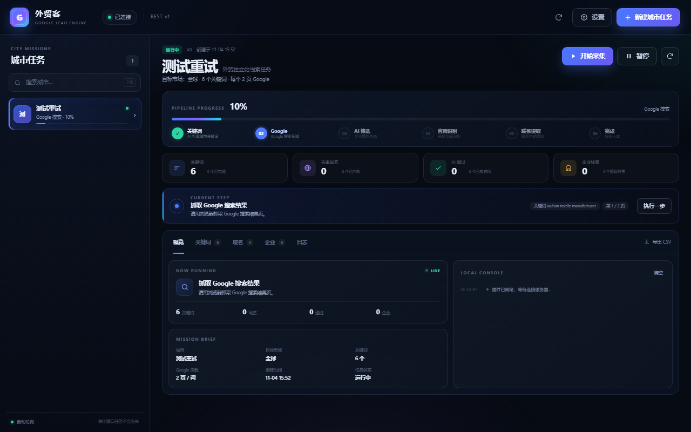

# 外贸客 · Google 线索引擎

原生 PHP MVC + Chrome Manifest V3 插件 + OpenAI 兼容 AI 中转站，用于从一座中国城市出发，批量发现面向海外市场的中国外贸企业独立站、品牌官网与 DTC 商城，并提取电话、邮箱、LinkedIn、TikTok、YouTube 等商务线索。

> 仅用于合法合规的 B2B 市场研究与商务联络。使用前请阅读目标网站服务条款、Google 搜索政策与所在地法律。



## 功能一览

- 输入城市（如「武汉」），AI 自动生成 6–60 个英文采购意图搜索词。
- 支持 **Serper.dev 官方搜索 API**（免人机验证，推荐）或浏览器直接抓取 Google，按关键词翻页并自动去重入域名库。
- 每 30 个域名一批交给 AI，判断是否为中国外贸企业独立站 / 品牌官网 / DTC 站。
- 对通过的站点抓取首页链接，AI 识别 Home、About Us、Contact 页面。
- 抓取关键页面，AI 提取公司名、手机/座机、邮箱、LinkedIn、TikTok、YouTube、WhatsApp、地址。
- 六阶段严格串行：上一阶段没有待处理项，才会进入下一阶段。
- 后台可暂停、继续、重试异常、查看执行日志、导出 CSV。
- 插件窗口固定 1280×800，支持任务列表、实时进度、域名/企业表格与本地控制台。

## 技术栈

| 层 | 实现 |
| --- | --- |
| 运行环境 | PHP 8.1+（推荐 8.2）/ MySQL 8 / Apache 或 Nginx |
| 后端 | 原生 PHP MVC、PDO 预处理、路由表、内置 QueryBuilder、迁移系统 |
| 前端后台 | 服务端渲染视图 + 原生 CSS/JS，无构建步骤 |
| 插件 | Chrome Manifest V3、Service Worker、`chrome.windows`、`chrome.scripting` |
| AI | OpenAI 兼容 `/chat/completions`，多中转站按优先级自动故障转移 |
| 搜索数据源 | Serper.dev Google Search API（支持插件端直连与服务端代理）+ 浏览器抓取双模式 |
| 密钥 | API Key 使用 `X-API-Key`；AI Key 与 Serper Key 使用 AES-256-GCM 加密入库 |

## 业务流程

```text
城市
  │  AI：关键词生成
  ▼
关键词表 ──► 插件逐个抓取 Google 第 1..N 页
  │              │  HTML / 结构化结果
  │              ▼
  │        搜索结果解析 → 域名去重 → 网址表
  ▼
AI 批量域名尽调（默认 30 个/批）
  │  仅 approved 进入下一步
  ▼
抓取首页 → AI 识别 Home / About / Contact
  │
  ▼
抓取关键页面 → AI 提取企业与联系方式
  │
  ▼
企业信息表 → 后台查看 / CSV 导出
```

六个阶段：

1. `keywords`：AI 生成关键词。
2. `serp`：Google 搜索翻页、域名去重。
3. `classify`：AI 判断企业独立站。
4. `discover`：识别官网关键页面。
5. `extract`：提取联系方式。
6. `done`：完成。

## 目录结构

```text
.
├── index.php                  # 唯一入口 / 前端控制器
├── install.php                # 表单安装器
├── migrate.php                # CLI + Web 迁移工具
├── dev-server.php             # 仅本地开发用路由器
├── .htaccess                  # Apache 重写规则
├── app/
│   ├── bootstrap.php          # 常量、自动加载、配置
│   ├── helpers.php            # 全局辅助函数
│   ├── routes.php             # 显式路由表
│   ├── Core/                  # App、Router、Request、Response、Db、QueryBuilder、Migration...
│   ├── Services/              # AI、管线、Google 解析、网站抓取、任务
│   ├── Modules/
│   │   ├── Admin/             # 后台控制器与视图
│   │   └── Api/               # 插件 REST API
│   └── Views/                 # 错误页等公共视图
├── migrations/                # 数据库迁移 + 默认提示词
├── config/                    # 配置样例；安装后生成 config.php
├── storage/                   # 锁文件、日志、缓存
├── assets/                    # 后台与安装器样式
├── extension/                 # Chrome 插件（可直接加载）
└── docs/                      # API 与 Byte 部署文档
```

## 环境要求

- PHP 8.1+，扩展：`pdo_mysql`、`curl`、`dom`、`mbstring`、`openssl`、`json`
- MySQL 8.0+，字符集 `utf8mb4`
- 可写目录：`config/`、`storage/`
- Apache 开启 `mod_rewrite` 并允许 `.htaccess`；Nginx 使用等价 `try_files` 规则
- 服务器可访问你的 AI 中转站（出站 HTTPS）
- Chrome 或 Edge 浏览器（Manifest V3）

> 服务器不直接访问 Google，也不直接抓取目标官网。Google 搜索与网页抓取全部由插件在用户浏览器中完成，以避免服务器 IP 被封与出站限制。

## 安装（虚拟主机 / Byte）

1. 在主机面板创建 MySQL 8 数据库，记录地址、端口、库名、用户名、密码。
2. 将本项目**除 `config/config.php` 与 `storage/installed.lock` 外的全部文件**上传到站点根目录。
3. 确认 `config/`、`storage/` 可写（Linux 通常 755 或 775，按主机要求）。
4. 浏览器访问 `https://你的域名/install.php`，填写数据库、站点地址、管理员和可选的 AI 中转站。
5. 安装器会：创建表 → 执行全部迁移（当前 5 个）→ 写入管理员 → 生成 API Key → 写 `config/config.php` 与 `storage/installed.lock`。
6. **立即保存安装完成页显示的 API Key**，然后登录 `https://你的域名/admin`。

详细 Byte 免费空间说明见 [docs/byte-deploy.md](docs/byte-deploy.md)。

### Apache 重写

根目录 `.htaccess` 已包含：

```apache
RewriteEngine On
RewriteCond %{REQUEST_FILENAME} !-f
RewriteCond %{REQUEST_FILENAME} !-d
RewriteRule ^ index.php [QSA,L]
```

### Nginx 等价配置

```nginx
location ~ ^/(app|config|storage|migrations)/ {
    deny all;
    return 404;
}

location ~ /\. {
    deny all;
    return 404;
}

location / {
    try_files $uri $uri/ /index.php?$query_string;
}
```

`.csv` 导出同样依赖上面的 `try_files`；若只配置静态文件服务而不转发到 `index.php`，导出会返回 404。

## 安装 Chrome 插件

1. 打开 `chrome://extensions/`（Edge 为 `edge://extensions/`）。
2. 开启右上角「开发者模式」。
3. 点击「加载已解压的扩展程序」，选择项目中的 `extension/` 目录。
4. 将插件固定到工具栏，点击图标打开 1280×800 的独立窗口。
5. 首次打开会自动弹出「连接服务器」：
   - **API 地址**：站点根地址，例如 `https://your-domain.com`，不要带 `/api`。
   - **API Key**：后台「系统设置」中查看或重新生成。
   - 可开启「自动推进任务」。
6. 点击右上角「新建城市任务」，输入城市即可开始。

插件权限说明：

- `storage`：保存 API 地址与 Key（仅本机）。
- `tabs` / `scripting`：当普通请求被 Google 或目标站拦截时，用隐藏标签页渲染真实 DOM。
- `host_permissions`：访问 Google 与目标官网，用于搜索和抓取。

窗口由 `chrome.windows` API 创建，该 API 不需要额外声明权限。

## 后台使用

- **总览**：任务、域名、企业、AI 中转站统计与实时动态。
- **城市任务**：按状态筛选、查看阶段进度、暂停/继续/重试、CSV 导出。
- **AI 中转站**：支持 OpenAI、DeepSeek、Moonshot、OneAPI/NewAPI 等兼容接口；按 `priority` 从小到大故障转移。
- **提示词模板**：四类提示词均可在后台直接编辑，保存后下一个任务立即生效。
- **系统设置**：插件 API 地址、API Key 轮换、关键词数量、Google 页数、批量大小、重试次数、请求间隔、JSON Mode。

默认参数：

| 参数 | 默认值 | 说明 |
| --- | --- | --- |
| `keyword_count` | 24 | 每个城市生成的关键词数 |
| `serp_pages` | 3 | 每个关键词抓取 Google 页数 |
| `classify_batch` | 30 | 每批 AI 域名判断数量 |
| `max_attempts` | 3 | 单站点/单页失败重试次数 |
| `google_domain` | www.google.com | 可改为 `www.google.com.hk` 等 |
| `request_delay_ms` | 2500 | 浏览器抓取请求间隔 |
| `search_provider` | auto | 搜索源：`auto`（优先 Serper）/ `serper` / `browser` |
| `serper_gl` / `serper_hl` | us / en | Serper 国家与语言代码 |
| `ai_json_mode` | 1 | 中转站不支持时自动回退 |

## 本地开发

```bash
# 1. 准备 MySQL 8 数据库
mysql -uroot -p -e "CREATE DATABASE gle_local CHARACTER SET utf8mb4 COLLATE utf8mb4_unicode_ci;"

# 2. 使用开发路由器启动（会正确处理 /api、.csv 与静态文件）
php -S 127.0.0.1:8080 dev-server.php

# 3. 打开安装器
# http://127.0.0.1:8080/install.php
```

没有伪静态的生产环境请使用 Apache/Nginx，不要依赖 `dev-server.php`。生产环境下该文件会直接返回 404。

### 数据库迁移

```bash
php migrate.php status
php migrate.php up
php migrate.php down 1
```

Web 方式：登录后台后访问 `/migrate.php`，或使用 `migrate.php?key=API_KEY`。

### 修改代码后

- PHP 文件：`php -l 文件.php`
- 插件 JS：`node --check extension/app.js`
- 修改迁移后不要直接改已执行文件，请新增一条迁移。

## 安全设计

- 后台使用 Session + CSRF；登录连续失败锁定 5 分钟。
- 插件 API 使用 `X-API-Key`，也兼容 `Authorization: Bearer` 与 `?key=`。
- 所有数据库写入使用 PDO 预处理；表名与前缀经过白名单。
- AI Key 使用 AES-256-GCM（`enc:v1:` + base64）加密，后台只显示掩码。
- `config/`、`storage/`、`migrations/` 均有独立 `.htaccess` 拒绝直接访问。
- API 响应统一为 JSON 信封，异常不暴露堆栈（`app.debug=false`）。
- 建议全站 HTTPS；插件 API Key 等同密码，轮换后旧 Key 立即失效。

## 常见问题

**插件提示「非 JSON 内容」**  
先确认 `https://域名/api/health` 在浏览器里返回 JSON。若响应里出现 `aes.js` / `__test`，是 InfinityFree 等免费主机的浏览器校验拦截了插件 `fetch`（不是伪静态问题）。插件会尝试自动打开一次标签页通过校验；仍失败请换用不带该校验的主机。API 地址须为站点根地址，不要带 `/api`。

**API 返回 401**  
API Key 为空、复制不完整或被轮换。到后台「系统设置」重新复制。

**Google 搜索被验证码拦截**  
插件会先尝试普通请求，再自动切换隐藏标签页；仍被拦截时会重试 3 次后跳过该页。降低频率、更换网络，或改用合规搜索数据源。

**AI 调用失败**  
检查中转站地址是否包含 `/v1`、Key 是否有效、模型是否支持 JSON 输出。后台「AI 中转站」会显示最近错误。

**网站抓取 403 / Cloudflare**  
普通 `fetch` 失败后会用真实标签页加载。强验证站点可能仍失败，系统会按重试次数跳过，不影响其他站点。

**登录 / 提交表单一直 419 CSRF_MISMATCH**  
Session 未在两次请求间保持。确认 `storage/sessions/` 可写；用 HTTPS 访问；清掉站点 Cookie 后刷新登录页再提交。勿开多个标签页同时登录。

**插件控制台反复「服务器开小差了」且卡在生成关键词**  
多为免费主机 PHP 约 60 秒超时或 AI 中转不可达。后台把中转站超时设为 35–45 秒，关键词先用 12，确认中转「测试」通过；API 现会返回更具体的超时说明。

**Byte 免费空间不能跑**  
免费空间通常限制出站网络、PHP 进程时长或 MySQL 权限。至少需要能访问 AI 中转站、写入 `config/` 与 `storage/`、执行 PDO MySQL。详见部署文档。

## 许可与合规

本项目仅提供技术实现，不授予任何数据抓取或营销许可。请确保：

- 遵守 Google 服务条款与 robots 规则；
- 只联系有合法商务需求的企业；
- 遵守 GDPR、CAN-SPAM、PECR 等适用法规；
- 不将数据用于骚扰、欺诈或侵犯隐私。

## 手机 App「好线索」

目录 `mobile/` 为 Expo 项目（可 GitHub Actions + EAS 打 APK）：

1. 执行迁移 `000006` 创建拨号队列表。
2. Chrome 插件企业列表点「拨号」→ 号码入库。
3. App 开启「接单」后每 10 秒领取并唤起系统拨号；企业页支持城市/公司/手机号搜索。

详见 [mobile/README.md](mobile/README.md)。

## 文档

- [API 接口](docs/API.md)
- [Byte 免费空间部署](docs/byte-deploy.md)
- [插件说明](extension/README.md)
- [手机拨号 App](mobile/README.md)
