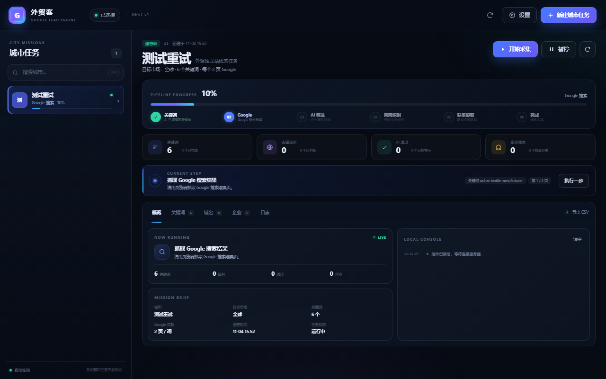

# 谷歌插件 · 外贸客

Chrome / Edge Manifest V3 插件，负责用真实浏览器访问 Google 和目标官网，把 HTML 交给你的 PHP 服务端，由服务端完成 AI 判断与数据入库。



## 安装

1. 打开 `chrome://extensions/`（Edge：`edge://extensions/`）。
2. 打开右上角「开发者模式」。
3. 点击「加载已解压的扩展程序」，选择本目录 `extension/`。
4. 把「外贸客」固定到工具栏。
5. 点击图标，弹出 1280×800 独立窗口。

首次打开会自动弹出连接设置：

- **API 地址**：`https://你的域名`（站点根地址，不要带 `/api`）。
- **API Key**：后台「系统设置」或安装完成页。
- **Google 搜索方式**：默认 **Serper.dev API（免验证 · 推荐）**，也支持由 PHP 服务端调用 Serper 或浏览器直接抓取 Google。
- **Serper.dev API Key**：已内置预填，也可在插件设置弹窗或后台「系统设置」中随时修改。
- **自动推进**：开启后按服务端 `next` 指令自动执行，直到任务完成/暂停。
- **请求间隔**：默认 2500ms（Serper 模式下自动使用 300ms 快速翻页）。

保存后点「测试连接」，绿色「已连接」即可。

## 界面

- **左侧任务栏**：所有城市任务与状态，点击切换。
- **顶部**：当前城市、阶段步骤条、进度、开始/暂停/重试。
- **统计卡**：关键词、域名、通过、企业、错误数。
- **当前动作**：服务端下发的下一步任务；「自动推进」关闭时可手动点「执行一步」。
- **数据面板**：概览、关键词、域名、企业、日志五个标签页。
- **导出 CSV**：调用服务端导出当前任务全部企业。
- **设置 / 新建任务**：右上角按钮。

窗口尺寸由 `background.js` 固定：

```js
chrome.windows.create({
  url: chrome.runtime.getURL('popup.html'),
  type: 'popup',
  width: 1280,
  height: 800
});
```

已有窗口时再次点击图标会聚焦，不会重复创建。

## 数据流

```text
popup/app.js
   │  chrome.runtime.sendMessage
   ▼
background.js（Service Worker）
   │  fetch / 隐藏标签页
   ├── Google 搜索结果 HTML
   └── 官网首页 / About / Contact HTML
   │
   ▼
POST /api/tasks/...（你的 PHP 服务）
   │
   ▼
MySQL + AI 中转站
```

插件不会直接调用 AI，也不会把 API Key 或 AI Key 写入页面。Google/网站 HTML 只发给你的服务器。

## 权限说明

| 权限 | 用途 |
| --- | --- |
| `storage` | 在本机保存 API 地址、API Key、自动推进、间隔 |
| `tabs` | 创建隐藏标签页抓取 Google/目标站；查询标签页状态 |
| `scripting` | 在隐藏标签页注入 DOM 提取函数 |
| `host_permissions: Google` | 访问 Google 搜索结果 |
| `host_permissions: http/https` | 访问目标企业官网 |

窗口由 `chrome.windows` API 创建，该 API 不需要额外声明权限。

Chrome 会提示「读取你的浏览历史」和「读取和更改你访问的网站数据」，这是抓取功能的必要条件。插件不会上传浏览历史，只处理当前任务需要的 URL。

## 抓取策略

### Google SERP

1. 优先 `fetch` Google 搜索 URL（带 `hl`、`num=10`、`start`）。
2. 若响应为空、429、验证码或非 HTML，切换到隐藏标签页：
   - `chrome.tabs.create({ active: false })`
   - 等待 `status=complete`
   - `chrome.scripting.executeScript` 注入 `extractSerpDom`
   - 关闭标签页
3. 服务端再次检查验证码特征；失败则重试，超过次数标记错误。

### 官网抓取

1. `fetch` 首页，非 HTML/403/超时则用隐藏标签页。
2. 提取页面标题、正文、所有链接（绝对 URL）。
3. 服务端 AI 识别 Home/About/Contact。
4. 依次抓取 About、Contact；失败时降级使用首页。
5. 把三页 HTML 提交给 `/extract`。

### 频率控制

- 每个动作之间按设置 `delay_ms` 等待。
- 同一任务同一阶段服务端有命名锁，重复提交返回 `409 task_busy`，插件会退避重试。
- 不要同时开多个插件窗口跑同一个任务。

## 开发

无构建步骤，修改后：

1. `chrome://extensions/` → 点击插件卡片「重新加载」。
2. 关闭旧弹窗，重新点击图标。

检查语法：

```bash
node --check extension/app.js
node --check extension/background.js
```

文件：

| 文件 | 作用 |
| --- | --- |
| `manifest.json` | MV3 配置、权限、图标 |
| `background.js` | 窗口单例、SERP/页面抓取、隐藏标签页 |
| `popup.html` | 1280×800 界面结构 |
| `styles.css` | 深色玻璃拟态样式、响应式 |
| `app.js` | 配置、API 客户端、轮询、动作循环、表格、弹窗 |
| `icons/` | 16/32/48/128 图标 |

## 常见问题

**点击图标没有反应**  
确认 `background.js` 无报错：`chrome://extensions/` → 插件「Service Worker」→ 检查控制台。若已有窗口被最小化，再次点击会聚焦。

**提示「非 JSON 内容」**  
浏览器打开 `https://域名/api/health` 应返回 JSON；`https://域名/bridge` 应显示 `bridge ready`。若直连 API 源码含 `aes.js`，属 InfinityFree 校验；插件会自动用 `/bridge` 标签页过检后请求。请使用 v1.0.3+ 插件并确保服务端已部署 bridge 页。

**提示「缺少 Key」/ 401**  
设置里重新粘贴 API Key；注意不要带空格。后台轮换 Key 后旧 Key 立即失效。

**Google 一直验证码**  
换网络/降低频率；插件已支持隐藏标签页兜底，但 Google 可能对自动化访问弹验证码。请遵守 Google 服务条款。

**官网抓取 403 / Cloudflare**  
隐藏标签页也未必能过强验证。系统会跳过并记录错误，不影响其他站点。

**弹窗尺寸不是 1280×800**  
Chrome 的窗口尺寸包含边框，内容区会略小；不同系统缩放（125%/150%）也会影响实际像素。代码按 1280×800 创建窗口。

## 隐私

- 配置只存 `chrome.storage.local`，不上传第三方。
- 不发遥测、不注入广告、不修改搜索结果页面。
- 只把任务相关的 Google/官网 HTML 发给你配置的 API 地址。
- 清除插件数据：`chrome://extensions/` → 移除插件，或在设置里清空配置。
